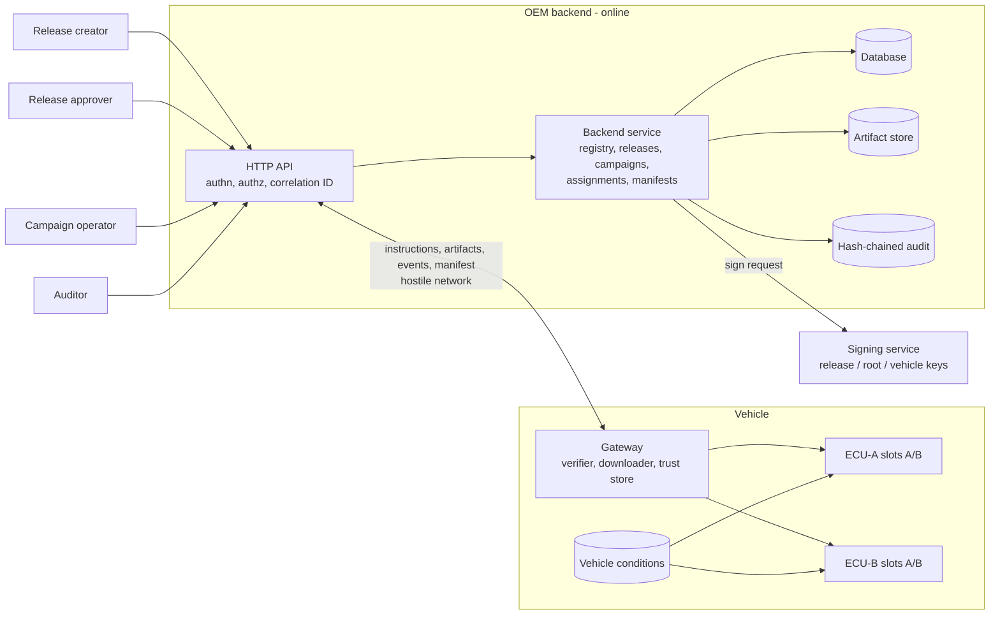

# SecureOTA-V Software Requirements Specification

| Field | Value |
|---|---|
| Version | 1.0-rc1 (review candidate) |
| Status | **Awaiting supervisor approval.** It becomes baseline 1.0 only after the W6-D5 review ([governance.md](governance.md)) |
| Owners | S1 vehicle sections, S2 backend sections, S3 security sections and integration |
| Reviewers | S3 reviews S1, S1 reviews S2, S2 reviews S3 (guide Section 11) |
| Source of truth | `trace/requirements.csv`; the full catalog is generated into [generated/requirements_catalog.md](generated/requirements_catalog.md) |

## 1 Introduction

### 1.1 Purpose

This document says what SecureOTA-V must do, how each requirement is verified, and which risk each
requirement answers. It is the input to Phase 3 (architecture, metadata and update-protocol design).

### 1.2 Research question and claim boundary

The project asks whether a simulated OTA pipeline can reject the attacks and survive the faults listed
in [threat_model.md](threat_model.md). It must do this while leaving at least one bootable, confirmed
firmware version on every ECU, with every decision traceable to evidence.

The claims are limited to the simulated test bench. Nothing here claims certification, type approval
or conformance with UN R156, ISO 24089, ISO/SAE 21434 or any other standard (see
[generated/standards_matrix.md](generated/standards_matrix.md)). Tested claims and future claims are
kept apart in [student3_security_spec.md](student3_security_spec.md) §1.4.

### 1.3 Definitions

| Term | Meaning |
|---|---|
| Artifact | A firmware image as uploaded, identified by `artifact_id` and its SHA-256 |
| Release | An artifact bound to an ECU, hardware ID and version. Its state is DRAFT, then APPROVED |
| Campaign | Approved releases plus explicit target vehicles and a policy. Its state is DRAFT, RUNNING or PAUSED |
| Assignment | One (campaign, vehicle, ECU) offer and its state: OFFERED, STAGED, INSTALLED, CONFIRMED, REJECTED or ROLLED_BACK |
| Signed target | Per-vehicle metadata envelope `{signed, key_id, sig}` (Ed25519) |
| Key set | Root-signed list of trusted release and vehicle keys, with a version, expiry and revocation list |
| Manifest | Vehicle version report signed with the vehicle key |
| Slot A/B | The two firmware slots on each ECU. Staging writes only the inactive slot |
| Trusted time | The gateway's wall clock, assumed trustworthy (ASM-01) |
| Correlation ID | An identifier carried by every request, event and audit record of one operation |

### 1.4 References

- *SecureOTA-V Merged Phase 2 Implementation Guide* (the phase guide)
- Phase 1 working path: Backend → Gateway → ECU-A → Slot B (repository root)
- Public standards sources listed in `trace/standards.csv`

## 2 Overall description

### 2.1 Scope

**In scope:**
- Simulated OEM backend: artifact store, release approval, campaigns, instructions, events, manifest
  and audit.
- A vehicle gateway and two simulated ECUs (ECU-A primary, ECU-B secondary).
- SHA-256 and Ed25519 verification, and a root-signed trusted key set.
- A/B staging, safety-gated activation, health confirmation and rollback.
- Simulated speed, battery, ignition, gear and diagnostic inputs.
- Normal, malicious, faulty and interrupted scenarios.

**Out of scope (guide Section 2):**
- Real vehicles and actuators.
- Certification.
- Custom cryptography.
- Hardware key storage.
- Cloud deployment and physical boards.
- A polished dashboard.

### 2.2 Actors

| Actor | Role in the authorization matrix | May | Must not |
|---|---|---|---|
| Release creator | `release_creator` | Upload artifacts and create draft releases | Approve own release (SR-18) |
| Release approver | `release_approver` | Approve a release, which makes it signable | Approve a release they created |
| Campaign operator | `campaign_operator` | Create, start and pause campaigns; view status | Approve releases or query audit |
| Auditor | `auditor` | Query the audit trail; view status | Change any state |
| Registrar | `registrar` | Register vehicles and ECUs | Anything else |
| Vehicle gateway | `vehicle` (bound to one vehicle_id) | Get instructions, download offered artifacts, report events, submit manifest | Act for another vehicle |
| Primary / secondary ECU | (in-vehicle) | Stage, activate, confirm and roll back its own slots | Write the active slot |
| Signing service | (separate trust boundary) | Sign approved releases and key sets | Sign drafts, or sign with a key outside its role |
| Research tester | (test bench only) | Inject attacks and faults | Touch anything outside the bench |

The full matrix is in [generated/authorization_matrix.md](generated/authorization_matrix.md).

### 2.3 System context

The trust-boundary diagrams are in [data_flows.md](data_flows.md).

### 2.4 Assumptions and constraints

The full register is in [student3_security_spec.md](student3_security_spec.md) §1.3. The key items:

- **ASM-01:** The gateway has a trusted clock.
- **ASM-02:** The root key is offline and is provisioned into the vehicle at the factory.
- **ASM-03:** Gateway-to-ECU calls are in-process. They are not authenticated (residual risk V-01).
- **ASM-05:** Transport is untrusted. TLS may be added but is not relied on for integrity.
- **ASM-07:** Root key rotation is out of scope.
- **Constraint:** Python 3.10 or newer, the `cryptography` library and FastAPI. Everything runs on one
  machine.

### 2.5 Data dictionaries

- ECU and gateway persistent fields (31 fields, each with a producer, a consumer and a validation
  rule): `trace/state_fields.csv`.
- Assets with their confidentiality, integrity and availability needs:
  [generated/asset_inventory.md](generated/asset_inventory.md).
- Backend entities and fields: [student2_backend_spec.md](student2_backend_spec.md) §1.

## 3 Requirements

### 3.1 Summary

| Class | Count | Owner split | Notes |
|---|---|---|---|
| FR functional | 15 | S1 vehicle flow; S2 backend | FR-14 is Should |
| SR security | 20 | S1 verifier; S2 API and audit; S3 keys and signing | |
| SAF safety and resilience | 10 | S1 | SAF-07 to SAF-10 proposed by S1 |
| NFR quality | 5 | S1, S2, S3 | |
| PR privacy | 1 | S2 | |
| US usability | 2 | S2 | |
| **Total** | **53** | | **51 Must, 2 Should (FR-11, FR-14)** |

**Status of the 53 requirements:**
- **Draft (36):** baseline requirements from the guide, refined by the team.
- **Proposed (17):** team additions. A new Must needs supervisor agreement (guide Section 5). The
  proposed IDs are FR-11 to FR-15, SR-13 to SR-20 and SAF-07 to SAF-10.

### 3.2 Requirement template

Every requirement row has these fields (guide Section 4):

`ID | class | statement with one SHALL and one observable outcome | priority | owner | reviewer | source (threat, use case or review item) | component | tests | status`

Evidence for each requirement goes through the matrix to an `evidence/` path.

### 3.3 Requirement catalog

The authoritative list is [generated/requirements_catalog.md](generated/requirements_catalog.md). The
groups below show how the catalog covers normal, failure and malicious behavior. This is acceptance
checklist item 2.

| Behavior | Requirements | Typical tests |
|---|---|---|
| Normal operation | FR-01 to FR-10, FR-12, FR-15, NFR-02, US-01 | ACC-01 to ACC-09, ACC-20 to ACC-29, E2E-01 |
| Failure | FR-10, FR-11, FR-13, SAF-01 to SAF-08, NFR-04 | FT-01 to FT-05, ACC-10 to ACC-15 |
| Malicious | SR-01 to SR-20, SAF-09, SAF-10, NFR-05, PR-01, US-02 | AT-01 to AT-31, QT-01, QT-02 |

### 3.4 Thresholds fixed in this baseline

| Parameter | Value | Requirement |
|---|---|---|
| `max_artifact_bytes` | 16 MiB (gateway and backend) | SR-12, SR-19 |
| `stall_timeout_s` / `total_timeout_s` | 10 s / 300 s | NFR-04 |
| `min_battery_v` | 12.0 V, configurable | SAF-04 |
| Speed allowed for activation | exactly 0 km/h; missing or non-finite counts as moving | SAF-03 |
| `health_timeout_s` / `max_boot_attempts` | 60 s / 3 | SAF-05 |
| Campaign `expires_in_s` | 60 s to 30 days | FR-07 |
| Benchmark sizes | 64 KiB, 1 MiB, 16 MiB | NFR-03 |

## 4 Verification

- Every Must requirement names at least one test in `tests/`. `tools/check_trace.py` fails the build if
  any test is missing (review item P2-03).
- Test types:
  - **ACC:** positive acceptance.
  - **AT:** attack; asserts rejection and unchanged trusted state.
  - **FT:** fault injection.
  - **QT:** quality.
  - **E2E:** backend to ECU.
- The test catalog is in [generated/test_catalog.md](generated/test_catalog.md).
- One command reproduces all evidence: `python run_all.py` (NFR-01).

## 5 Change control

From approval onward, changing a Must requirement, a high-risk score, a public contract or a security
assumption needs four things: an issue, an impact analysis, reviewer approval and a change-log entry in
[governance.md](governance.md). `tools/check_trace.py` and `tools/build_docs.py --check` stop silent
edits to the generated tables.

## 6 Approval

| Role | Name | Decision | Date |
|---|---|---|---|
| Student 1 | | | |
| Student 2 | | | |
| Student 3 | | | |
| Supervisor | | | |
