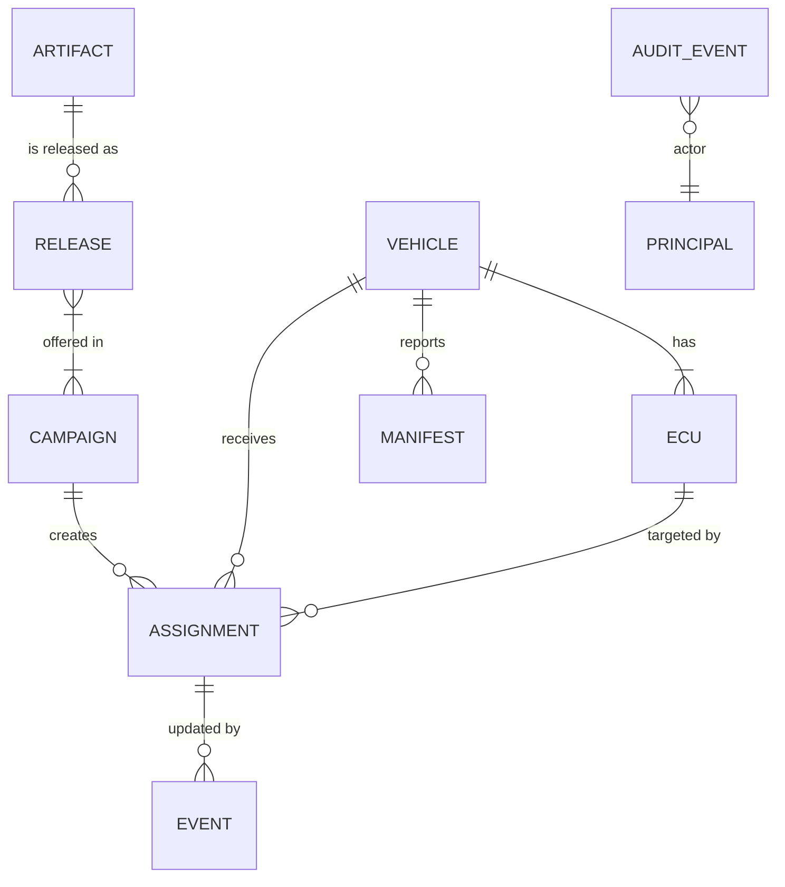
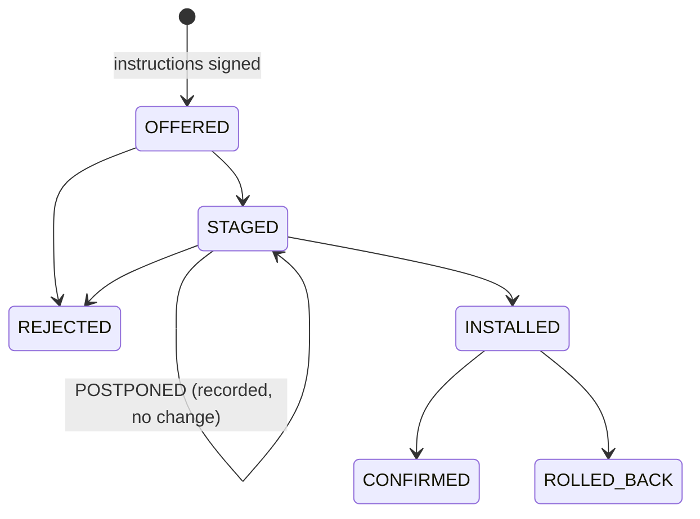

# SecureOTA-V Merged Phase 2 — S2: Backend, API and DevSecOps

Version 1.0-rc1 (review candidate). Author: Omar Hossam Wafa. Checked against S1 (vehicle-facing fields)
and S3 (privileged actions, audit, security boundaries).

This document covers work packages S2-T1 to S2-T4. `oem_backend/` is an executable version of the same
behavior and `tests/test_backend.py` and `tests/test_e2e.py` prove it. The storage is in memory. A real
database and object store replace it in the implementation phase, and the rules below stay the same.

---

## S2-T1 Backend domain and API behavior

### 1 Conceptual data model

| Concept | Essential fields | Owner (writes) | Consistency rules |
|---|---|---|---|
| Vehicle | vehicle_id, manifest_key_id, manifest_public_key, last_manifest_at | registrar; manifest updates last_manifest_at | Unique vehicle_id; allowed fields only (PR-01) |
| ECU | ecu_id, hardware_id, active_version, confirmed_version, update_state | registrar (identity); manifest (versions) | ecu_id unique per vehicle; versions only from a verified manifest |
| Artifact | artifact_id = `art-` + sha256[:16], sha256, length, ecu_id, hardware_id, uploaded_by | release creator | Immutable after upload; same ID with different content is CONFLICT |
| Release | release_id, artifact_id, ecu_id, hardware_id, version, sha256, length, state DRAFT→APPROVED, created_by, approved_by | creator, then approver | sha256 and length copied from the artifact (SR-01); approved_by ≠ created_by (SR-18); version unique per ECU and hardware |
| Campaign | campaign_id, release_ids, targets, policy {expires_in_s, require_safe_state}, dependencies, ecu_order, state DRAFT/RUNNING/PAUSED | operator | Only approved releases; at most one release per ECU; targets registered and compatible; acyclic dependencies |
| Assignment | (campaign, vehicle, ecu), release_id, state, metadata_version, envelope, reason, history | backend on offer; vehicle events | Transitions only per the table in S2-T2; offer content always built from the release record |
| Manifest | signed {vehicle_id, generated_at, correlation_id, ecus[]} | vehicle | Signature under the registered key; complete; strictly newer (SR-20) |
| AuditEvent | seq, time, actor, action, object, outcome, correlation_id, code?, prev_hash, hash | backend only | Append-only; hash chain; no secret-named fields (SR-14, NFR-05) |

### 2 API behavior catalog

Every response carries `correlation_id`, in the body and in `X-Correlation-ID`. Every call writes one
audit event with outcome SUCCESS, DENIED or FAILED. Error bodies are always
`{error, code, message, correlation_id}`.

| Endpoint | Actor | Precondition | Success | Validation / authz / not-found / conflict | Audit action |
|---|---|---|---|---|---|
| `GET /health` | anyone | - | 200 `{status: ok}` | - | none (not privileged) |
| `POST /vehicles` | registrar | new vehicle_id | 201 `{vehicle_id, ecus}` | 422 INVALID_IDENTITY, UNEXPECTED_FIELD, MISSING_FIELD, NO_ECUS, INVALID_KEY; 409 DUPLICATE_VEHICLE, DUPLICATE_ECU | register_vehicle |
| `POST /artifacts?ecu_id&hardware_id` | release_creator | body ≤ 16 MiB | 201 `{artifact_id, sha256, length, ecu_id, hardware_id}` | 413 ARTIFACT_TOO_LARGE; 422 EMPTY_ARTIFACT, INVALID_IDENTITY; 409 ARTIFACT_CONFLICT | upload_artifact |
| `POST /releases` | release_creator | artifact exists | 201 `{release_id, state: DRAFT}` | 404 UNKNOWN_ARTIFACT; 422 INVALID_VERSION; 409 VERSION_EXISTS | create_release |
| `POST /releases/{id}/approve` | release_approver ≠ creator | release DRAFT | 200 `{state: APPROVED}` | 404; 409 NOT_DRAFT; 403 SEPARATION_OF_DUTIES | approve_release |
| `POST /campaigns` | campaign_operator | releases APPROVED | 201 `{campaign_id, state: DRAFT, ecu_order}` | 422 INVALID_TARGETS, UNKNOWN_TARGET, INCOMPATIBLE_TARGET, INVALID_POLICY, DUPLICATE_ECU_RELEASE, INVALID_DEPENDENCIES, DEPENDENCY_CYCLE (+ diagnostic); 404; 409 RELEASE_NOT_APPROVED | create_campaign |
| `POST /campaigns/{id}/start` | campaign_operator | DRAFT or PAUSED | 200 RUNNING | 404; 409 INVALID_CAMPAIGN_STATE | start_campaign |
| `POST /campaigns/{id}/pause` | campaign_operator | RUNNING | 200 PAUSED | 404; 409 | pause_campaign |
| `GET /campaigns/{id}/status` | operator, auditor | - | 200 assignments with state and label (US-01) | 404 | view_status |
| `GET /vehicles/{vid}/instructions` | vehicle (own vid) | - | 200 `{bundles: [{campaign_id, targets: [envelope]}]}` | 403 other vehicle; 404 UNKNOWN_VEHICLE; 409 SIGNING_REFUSED | get_instructions |
| `GET /artifacts/{id}` | vehicle | artifact offered to this vehicle | 200 bytes | 404 UNKNOWN_ARTIFACT (also when not offered, to prevent enumeration) | download_artifact |
| `POST /vehicles/{vid}/events` | vehicle (own vid) | assignment exists | 200 `{assignment_state, duplicate}` | 422 INVALID_EVENT_ID, INVALID_OUTCOME; 404 UNKNOWN_ASSIGNMENT; 409 STALE_EVENT, INVALID_TRANSITION, EVENT_ID_REUSED | report_event |
| `POST /vehicles/{vid}/manifest` | vehicle (own vid) | registered key | 200 `{accepted, ecus}` | 422 BAD_SIGNATURE, UNTRUSTED_KEY, MALFORMED_METADATA, VEHICLE_MISMATCH, MANIFEST_INCONSISTENT, MANIFEST_INCOMPLETE; 409 STALE_MANIFEST | submit_manifest |
| `GET /audit?actor&action&correlation_id` | auditor | - | 200 `{chain_intact, first_bad_seq, events}` | 403 | query_audit |
| any | no or invalid token | - | - | 401 UNAUTHENTICATED (audited as `anonymous`) | authenticate |
| any | - | unexpected exception | - | 500 INTERNAL, fixed message, no path or trace (SR-11) | - |

**Field contract with the vehicle.** For review item P2-10, S1 validates this against
`trace/state_fields.csv`. The signed target fields are exactly `artifact_id, campaign_id, vehicle_id,
ecu_id, hardware_id, version, metadata_version, length, sha256, expires_at`. They match
`vehicle/metadata.py TARGET_FIELDS`. Event outcomes use the ECU state names (STAGED, INSTALLED,
CONFIRMED, REJECTED, ROLLED_BACK) plus POSTPONED. Manifest ECU entries are `Ecu.report()`.

---

## S2-T2 Backend functional and quality requirements

The requirements owned here are FR-01, FR-02, FR-07, FR-12, FR-13, FR-14, FR-15, SR-08, SR-09, SR-11,
SR-14, SR-18, SR-19, SR-20, NFR-01, NFR-02, PR-01, US-01 and US-02. The statements are in
[generated/requirements_catalog.md](generated/requirements_catalog.md).

### Lifecycles

| Entity | Transitions |
|---|---|
| Artifact | created at upload; immutable |
| Release | DRAFT → APPROVED (approver ≠ creator) |
| Campaign | DRAFT → RUNNING (start); RUNNING → PAUSED (pause); PAUSED → RUNNING (start) |

Assignment state, driven by instructions and vehicle event reports:

**Notes:**
- An OFFERED assignment whose envelope has expired is re-signed with a higher `metadata_version`.
- REJECTED and ROLLED_BACK are final for that campaign. Re-offering needs a new campaign (operator
  decision, Q-S2-2).
- Campaign completion (COMPLETED) is not modeled in this phase.

### Authorization matrix

The generated version is [generated/authorization_matrix.md](generated/authorization_matrix.md).
Every privileged action names exactly the roles allowed. Two rules sit on top of the matrix:
- approver ≠ creator (SR-18)
- vehicle identities act only on their own vehicle_id (SR-08)

### Correlation, logging, timeouts, deployment

- **Correlation:** A caller-supplied `X-Correlation-ID` matching `[A-Za-z0-9-]{8,64}` is reused. Any
  other value is replaced by a random 32-hex ID. The same ID flows to the signing request, to the
  vehicle (`process_bundle(..., cid)`) and to every audit event (ACC-29).
- **Structured logs:** Audit events are JSON-like records with fixed keys. Field names containing
  token, password, secret, private, credential or passphrase are refused (NFR-05).
- **Timeouts:** The backend serves artifacts in 64 KiB chunks. The vehicle enforces stall and total
  timeouts (NFR-04). Server-side request timeouts belong to the deployment decision in Phase 3.
- **Clean deployment:** `pip install -r requirements.txt` then `python run_all.py` (NFR-01, QT-04).

---

## S2-T3 Backend threats and consistency failures

The STRIDE worksheet is in [threat_model.md](threat_model.md) §3.1. Risk entries B-01 to B-09 and T-10
and T-12 are in [generated/risk_register.md](generated/risk_register.md).

| Consistency rule | How it is enforced | Test |
|---|---|---|
| A failed request leaves no partial change | Every operation runs in `_tx()`, which restores the whole store on any exception | ACC-20 (duplicate ECU leaves no vehicle), ACC-22 |
| Artifact and assignment state cannot silently change target content | Offers are built and signed from the APPROVED release record; the gateway verifies every signed field | AT-23, AT-18 |
| Retried event reports are idempotent | `event_id` stored with a digest of the body; same body returns the original result, different body is CONFLICT | AT-30 |
| Stale reports cannot move a newer offer | Event must carry the assignment's current `metadata_version` | AT-30 (STALE_EVENT) |
| Only legal transitions | Transition table | ACC-23 |
| Reconciliation after vehicle/backend disagreement | Signed manifest is the source of truth for installed versions; eligibility uses reported versions | E2E-01 |
| Bounded resources | 16 MiB body limit checked on Content-Length and actual body | AT-29 |

**Open questions for review:**

| ID | Question | Proposed answer |
|---|---|---|
| Q-S2-1 | Should event reports be signed with the vehicle key, not only token-authenticated? (B-08 residual) | Yes, decide in Phase 3 together with the Uptane-style per-ECU report |
| Q-S2-2 | How does an operator retry a REJECTED or ROLLED_BACK assignment? | New campaign or explicit `retry` action. Phase 3 |
| Q-S2-3 | Rate limiting (B-06 residual) | Deployment-level (reverse proxy). Out of scope for Phase 2 |

---

## S2-T4 Phase baseline and reproducibility package

| Item | Where |
|---|---|
| Templates (requirement, threat, risk, decision, review, test) | CSV headers in `trace/`, test docstring format `<ID> \| <threats> \| <requirements>`, review and decision tables in [governance.md](governance.md) |
| Version numbers, change log, review status, evidence locations | [governance.md](governance.md) §1–§4; `status` columns in `trace/*.csv` |
| Documented validation commands | `tools/check_trace.py` (identifiers and links), `tools/build_docs.py --check` (tables match sources), `tools/scan_secrets.py`, `run_all.py` |
| Evidence index | [governance.md](governance.md) §5 |
| Clean reproduction record | [governance.md](governance.md) §6 (to be filled by S1 and S3 from a fresh clone) |

## Weekly evidence map

| Week | Guide evidence | Where |
|---|---|---|
| 3 | Backend actors, vocabulary, data concepts, draft FRs | §1 data model, SRS §2.2, FR rows in `trace/requirements.csv` |
| 4 | API use cases, authorization matrix, audit and quality requirements | §2 API catalog, [use_cases.md](use_cases.md) UC-01 to UC-04 and UC-11, generated authorization matrix |
| 5 | Backend STRIDE, consistency failures, risk scores | [threat_model.md](threat_model.md) §3.1, S2-T3 table, B-xx rows |
| 6 | Integrated baseline, review minutes, change log, clean reproduction | `run_all.py`, [governance.md](governance.md) |
