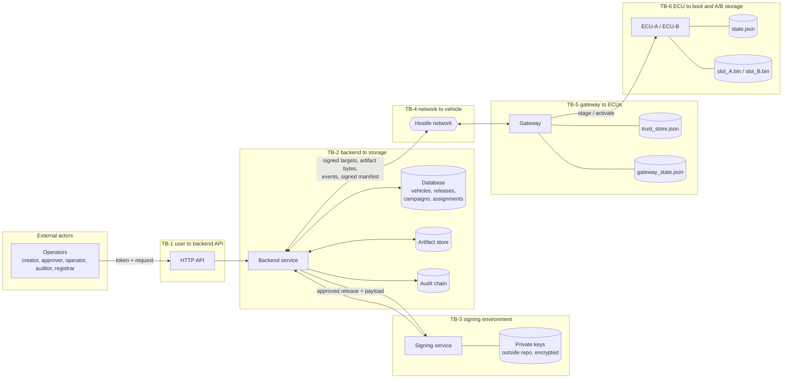
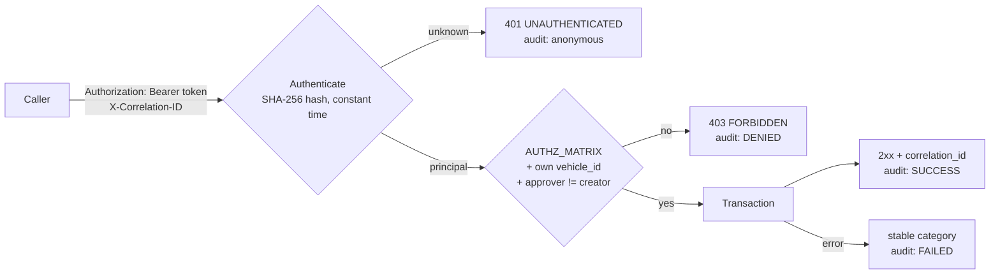
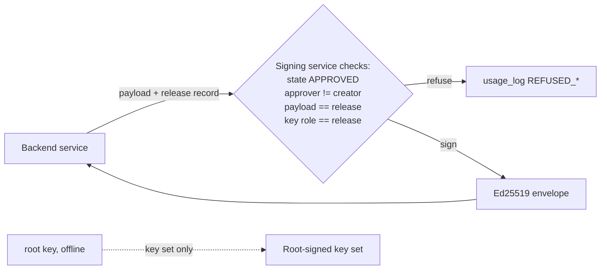
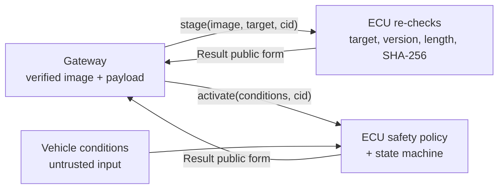

# Data flows and trust boundaries

Version 1.0-rc1. Trust boundaries are reviewed from the S3 security view. The diagrams are Mermaid and render
on GitHub and in VS Code.

This document covers the six trust boundaries required by guide Section 3. For each one it lists what
crosses the boundary, how trust is established, the controls in place and the threats examined in
[threat_model.md](threat_model.md).

## System data-flow diagram

## TB-1 User to backend API: identity, authentication, authorization, audit

| Crosses | Trust established by | Controls | Threats |
|---|---|---|---|
| Credentials, JSON bodies, artifact bytes | Token lookup and role check | SR-08, SR-09, SR-11, SR-19, NFR-02, PR-01 | T-10, B-01, B-02, B-06, B-07 |

## TB-2 Backend to database and object storage: integrity, transactions, access

| Crosses | Trust established by | Controls | Threats |
|---|---|---|---|
| Entity records, artifact blobs, audit events | Only the service writes. Every request is one transaction | Transaction rollback; transition table; signed content built from release records; hash-chained audit with exported anchor | B-03, B-04, B-05, B-08 |

The key design point is that the vehicle never trusts storage. A changed blob fails the digest check
(AT-18) and a changed offer fails the signature check (AT-23). Storage compromise therefore becomes a
failed update, never a malicious install.

## TB-3 Signing environment to online backend: key separation and approval

| Crosses | Trust established by | Controls | Threats |
|---|---|---|---|
| Sign requests out; signatures back. Private keys never cross | Signing service is a separate component holding the keys | SR-10, SR-15, SR-17, SR-18; usage log | K-01, K-04, B-09 |

Residual risk: the signing service trusts the release record it is given. If the backend is fully
compromised, it can present a forged approval. The production answer is approver signatures, threshold
signing or offline image signing, recorded as decision D-06 for Phase 3.

## TB-4 Network to vehicle gateway: hostile transport

| Crosses | Trust established by | Controls | Threats |
|---|---|---|---|
| Signed target bundles, artifact bytes (in), event reports and signed manifest (out), key-set updates | Ed25519 signature under the trusted key set. The transport is not trusted | SR-02 to SR-07, SR-12, SR-16, NFR-04 | T-01 to T-09, T-11, K-02 |

This is why TLS alone is not enough. TLS protects bytes on one link. It does not protect against a
compromised backend or storage (B-03, B-04), a replayed but validly delivered old release (T-03,
T-04), or a stolen server certificate. End-to-end signatures checked on the vehicle do.

## TB-5 Gateway to primary and secondary ECUs: vehicle network and peer trust

| Crosses | Trust established by | Controls | Threats |
|---|---|---|---|
| Image and target, activation commands, safety inputs, reports | Defense in depth: the ECU repeats checks and accepts commands only in a matching state | SR-05, SR-06, SR-02 at ECU, SAF-03, SAF-04, SAF-10 | V-01, V-02, V-05 |

Calls are in-process in Phase 2 (ASM-03). Message authentication on a real bus is open decision D-04.

## TB-6 ECU application to boot state and A/B storage: persistence and recovery

| Crosses | Trust established by | Controls | Threats |
|---|---|---|---|
| state.json commits, slot image writes, boot reads | Atomic replace; digest recorded per slot; only the inactive slot is written | SAF-01, SAF-02, SAF-06 to SAF-09, FR-05, FR-10 | F-03, F-04, V-03, V-04 |

The checkpoint recovery matrix (12 checkpoints) is in
[vehicle_spec.md](vehicle_spec.md) §S1-T3.

## Trusted vs untrusted data

| Trusted | Becomes trusted when | Never trusted |
|---|---|---|
| Provisioned root public key; ECU `state.json`; `trust_store.json` (re-verified on load) | Downloaded bytes, once length and SHA-256 match verified metadata. A key set, once root-signed and newer | Network responses, database rows as seen by the vehicle, vehicle-state inputs, commands arriving at an ECU, event reports (authenticated, but not proof of state) |
