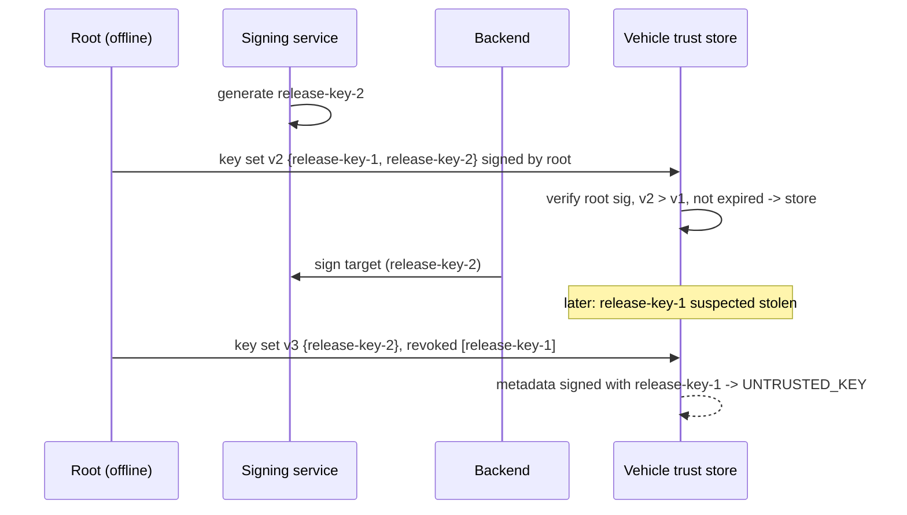

# SecureOTA-V Merged Phase 2 — S3: Security, Research and Verification

Version 1.0-rc1 (review candidate). Author: Omar Hossam Wafa. Checked against S2 (security requirements and
key lifecycle) and S1 and S2 (attacker realism for their components).

This document covers work packages S3-T1 to S3-T4. `security/` holds the key-lifecycle prototype, and
`tests/test_security.py` proves it. `tools/check_trace.py`, `tools/scan_secrets.py` and
`tools/bench_verify.py` are the verification tools.

---

## S3-T1 Security assumptions and attacker capabilities

### 1.1 Attacker model

| ID | Attacker | Can | Cannot (explicit boundary) | Main threats |
|---|---|---|---|---|
| ATK-NET | Network attacker | Observe, modify, delay, replay or block any traffic between backend and vehicle; serve arbitrary bytes | Hold an authorized signing key; break Ed25519 or SHA-256 | T-01 to T-09, T-11, K-02 |
| ATK-OP | Malicious operator | Use legitimate credentials for one role, including outside its intended purpose | Bypass the authorization matrix or rewrite the audit anchor | T-10, T-12, B-02, B-05 |
| ATK-SVC | Compromised online service | Change database rows, object storage and API responses | Use the offline root key; produce a valid vehicle-key signature | B-03, B-04, B-06, K-01 |
| ATK-SIGN | Unauthorized signer | Produce signatures with keys outside the trusted set, or with a stolen key until it is revoked | Add a key to the vehicle's trusted set without the root key | T-02, K-03, K-04 |
| ATK-ECU | Compromised ECU / CAN peer | Send false status, unsolicited commands or forged sensor values on the vehicle network | Control every ECU; change another ECU's persistent storage | V-01, V-02, V-05 |
| ATK-FAULT | Fault injector | Kill processes, cut the network, simulate power loss at defined checkpoints, corrupt flash | Act outside the controlled test bench | F-01 to F-05, V-03 |
| ATK-INS | Careless insider | Commit secrets, log credentials | - (a mistake, not an attack) | B-07, B-09 |

Every security requirement in `trace/requirements.csv` has a source threat, and each threat names its
attacker. This is completion check S3-T1.1.

### 1.2 Trusted computing base

The prototype trusts:
- the `cryptography` and `hashlib` libraries
- the Python runtime on the test host
- the provisioned root public key
- the vehicle's local persistent storage, apart from the specific corruption faults that are injected

### 1.3 Security assumptions register

| ID | Assumption | Consequence if false | Limits which conclusion | Owner |
|---|---|---|---|---|
| ASM-01 | The gateway has a trusted wall clock (`clock()`). | Expired metadata could be accepted after clock rollback (T-07). Expiry results are valid only under this assumption | AT-07 | S3 |
| ASM-02 | The root key is offline and its public key is provisioned at the factory, never over the network. | Root compromise defeats every key-set control | AT-24, AT-25, ACC-30 | S3 |
| ASM-03 | Gateway-to-ECU calls are in-process and cannot be injected except as modeled in AT-13. | A real bus needs message authentication (V-01, decision D-04) | AT-13 | S1 / supervisor |
| ASM-04 | The test host is not compromised. | All results are invalid | everything | all |
| ASM-05 | The transport is untrusted. TLS may be used but is not relied on for integrity or authenticity. | None. This is the conservative choice | - | S3 |
| ASM-06 | No physical attacker reads the ECU flash or debug ports. | Key extraction and image replacement outside the update path are untested | - | S3 |
| ASM-07 | Root key rotation and threshold signing are out of scope. A vehicle with an expired key set must be re-provisioned. | Root-key lifecycle claims are not made | K-02 | S3 |
| ASM-08 | Firmware is not confidential, so no encryption of images is required. | Reverse-engineering risk is not addressed | - | S3 |
| ASM-09 | The signing service is a separate component. In the prototype it is a separate object in the same process. | Process isolation is not tested | AT-26 | S3 |
| ASM-10 | Simulated tokens stand in for real authentication. They have no expiry or rotation. | B-01 residual: a stolen token works until removed | AT-20 | S2 |

### 1.4 Claims boundary

| Tested claims (Phase 2 evidence) | Not claimed (future or production) |
|---|---|
| On the simulated bench, every attack in AT-01 to AT-31 is rejected with a stable reason, and trusted vehicle state is byte-identical afterwards | Resistance against attackers outside §1.1 |
| At every one of the 12 defined checkpoints, power loss leaves a bootable confirmed image (FT-03, ACC-15) | Behavior of real flash, partial sector writes, wear |
| The authorization matrix, separation of duties and audit chain behave as specified (AT-10, ACC-25, AT-28) | Production identity management, HSM-backed keys |
| Measured verification latency on one reference machine (NFR-03) | Performance on ECU-class hardware |
| Design is informed by public Uptane, TUF, UN R156 and NHTSA themes | Certification, type approval or conformance with any standard |

---

## S3-T2 Security and key-lifecycle requirements

S3 owns or co-owns SR-01, SR-04, SR-07, SR-10, SR-15, SR-16, SR-17, NFR-03 and NFR-05, and reviews
every other SR. The statements are in
[generated/requirements_catalog.md](generated/requirements_catalog.md).

### 2.1 Cryptographic building blocks (no custom primitives)

| Purpose | Mechanism | Library |
|---|---|---|
| Artifact integrity | SHA-256 over the exact bytes, plus exact length | `hashlib` |
| Metadata, key-set and manifest authenticity | Ed25519 over canonical JSON (sorted keys, no whitespace, ASCII, no NaN) | `cryptography` |
| Key storage at rest | PKCS#8 with `BestAvailableEncryption` and a passphrase from the environment | `cryptography` |
| Digest comparison | `hmac.compare_digest` | stdlib |

### 2.2 Freshness and anti-replay

| Protection | Mechanism | Requirement / test |
|---|---|---|
| Expiry | `expires_at` > trusted time (ASM-01) | SR-07 / AT-07 |
| Replay of older metadata | Per-ECU `metadata_version` must not decrease. An equal version must be byte-identical (idempotent) | SR-07 / AT-03, ACC-08 |
| Downgrade | `version` ≥ ECU `trusted_min_version`, which rises only on health confirmation | SR-06 / AT-04 |
| Mix-and-match | Every target in a bundle has the bundle's campaign and the gateway's vehicle_id. One bad target rejects the bundle | SR-07 / AT-06 |
| Key-set rollback | Key-set version must strictly increase | SR-16 / AT-24 |
| Manifest replay | `generated_at` strictly increases per vehicle | SR-20 / AT-19 |

### 2.3 Key lifecycle concept

| Key | Role | Generation | Storage | Use | Rotation | Revocation | Compromise response |
|---|---|---|---|---|---|---|---|
| Root | `root` | Offline, once per project | Offline only (simulated in memory) | Signs key sets only | Out of scope (ASM-07) | - | Re-provision vehicles |
| Release | `release` | Signing service | Signing service. Export only encrypted, outside the repo (SR-10) | Signs per-vehicle targets for APPROVED releases (SR-15) | New key set version listing the new key, then switch the backend's `release_key_id` (ACC-30) | Key set v+1 with the key in `revoked` (AT-25) | Revoke, rotate, re-sign pending offers, review the usage log, audit releases signed since suspected compromise |
| Vehicle | `vehicle` | At provisioning, one per vehicle | Vehicle (simulated). Public key registered in the backend | Signs the version manifest (SR-13) | Re-registration (Phase 3) | Remove from registry; manifest then fails | Re-provision vehicle key |

### 2.4 Secret handling rules (SR-10, NFR-05)

1. No private key, passphrase or token is written to any file in the repository. `.gitignore` excludes
   `*.pem`, `*.key` and `phase2/evidence/`.
2. `SigningService.export_key` and `load_key` refuse paths inside the source tree. Exported keys are
   always encrypted.
3. `tools/scan_secrets.py` runs in `run_all.py` over every tracked or addable file, and again over the
   evidence directory. It reports file and rule only, never the matched text.
4. Audit events refuse field names that look like secrets. Tokens are held only as SHA-256 hashes.
5. External errors are fixed messages (SR-11).

---

## S3-T3 TARA, STRIDE and attack-tree workshops

- Worksheets for every component, flow and store: [threat_model.md](threat_model.md) §3. Every one of
  the six trust boundaries is covered (coverage line under §3.3).
- Attack trees for malicious installation, downgrade, wrong target and key misuse: §4.
- The integrated catalog and register (35 entries, 27 high or critical, all with owners and a written
  rationale) are in [generated/risk_register.md](generated/risk_register.md).
- Normalization rules applied to the draft scores:
  - Likelihood 5 is used only for events that happen without an attacker (F-01).
  - Impact 5 is reserved for malicious code execution, unsafe activation, an unbootable ECU or key
    compromise.
  - Duplicates merged: guide T-10 absorbs backend "broken authorization", and B-02 is kept separate
    because its control (SR-18) is distinct.
- Residual risks that need a supervisor decision are listed in
  [security_review.md](security_review.md) §4.

## S3-T4 Standards and evidence traceability

- **Standards matrix:** [generated/standards_matrix.md](generated/standards_matrix.md) (15 rows).
  Every row is *Informed by* or *Mapped to*. `check_trace.py` rejects compliance or certification
  wording. ISO 24089 and ISO/SAE 21434 are marked "full text NOT accessed". Clause numbers for UN R156
  must be confirmed against the public UNECE text before they are quoted (action A-03).
- **Master matrix:** [generated/traceability_matrix.md](generated/traceability_matrix.md) (64 rows).
  It covers every Must requirement and every high or critical risk.
- **Checks:** `python tools/check_trace.py`. They cover review items P2-02, P2-03, P2-06, P2-08 and
  P2-09.
- **Security review report:** [security_review.md](security_review.md).

## Weekly evidence map

| Week | Guide evidence | Where |
|---|---|---|
| 3 | Attacker model, assumptions register, security requirement outline | §1.1–1.4 |
| 4 | Security requirements, key-lifecycle concept, initial standards matrix | §2, `trace/standards.csv` |
| 5 | Integrated workshops, attack trees, prioritized risk register | [threat_model.md](threat_model.md), generated risk register |
| 6 | Final traceability matrix, security review, unresolved-risk decision list | generated matrix, [security_review.md](security_review.md) |
