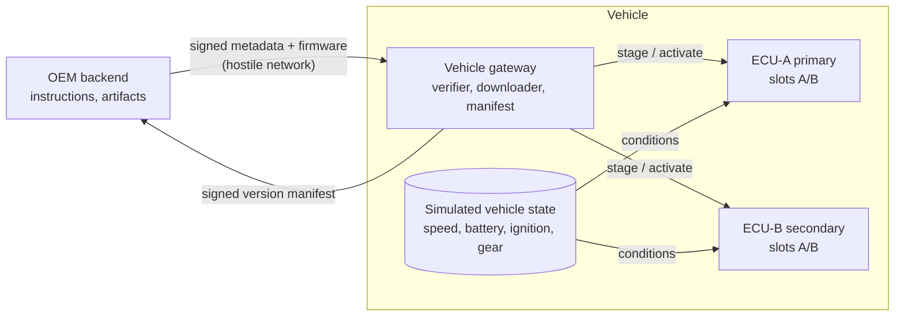
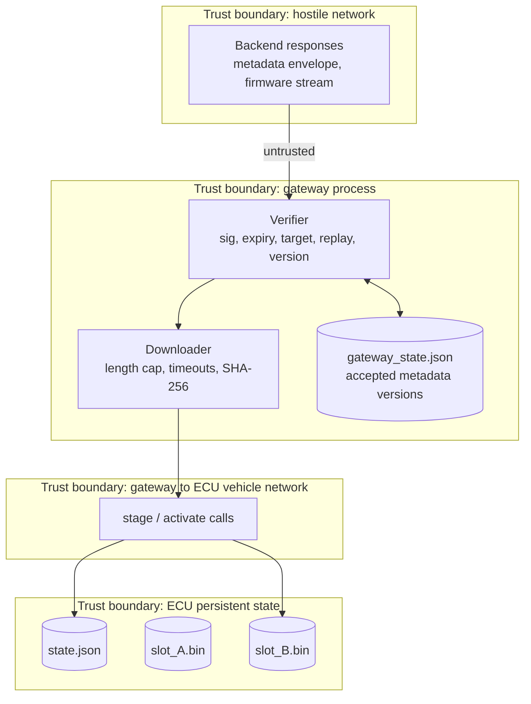
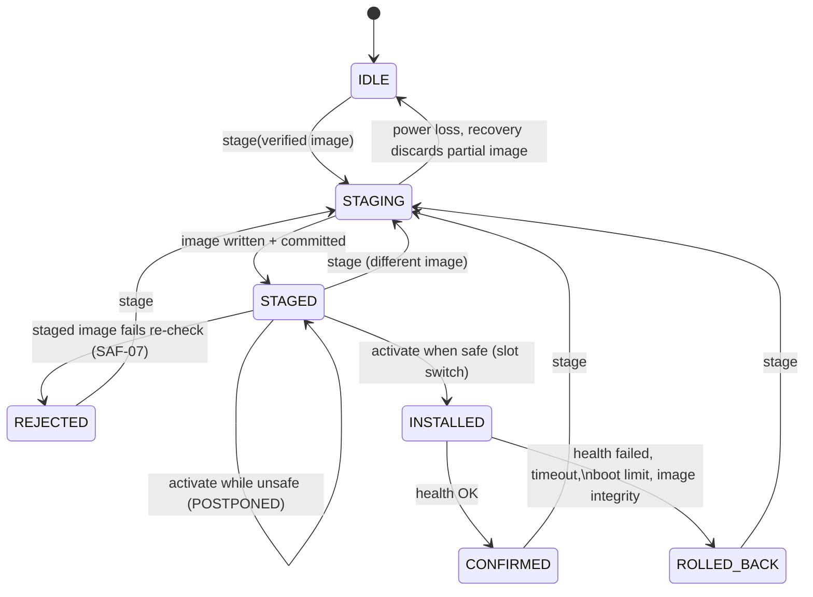
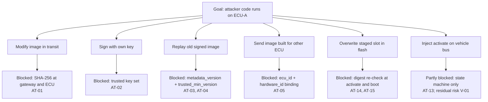

# SecureOTA-V Merged Phase 2 — Student 1: Vehicle, Gateway and ECU

Version 1.0-rc1 (review candidate, merged package) · Owner: Student 1 · Reviewers: Student 3 (requirements, threats), Student 2 (fields, APIs)

This document is the written part of work packages S1-T1 to S1-T4. The code in `vehicle/` is an
executable version of the same behaviour, and `tests/` proves it. Machine-readable tables live in
`trace/` and are checked by `tools/check_trace.py`.

Phase 2 is a requirements and threat phase. The code is a feasibility prototype (schedule item W6-D2),
not the final architecture. Real CAN transport, real flash drivers and hardware key storage are
deliberately out of scope.

---

## S1-T1 Vehicle and ECU boundary

### Context

| Component | Responsibility | Not responsible for |
|---|---|---|
| Gateway | Verify metadata (signature, freshness, target, version), download with limits, route to ECU, build signed manifest | Choosing campaigns, signing releases |
| ECU (primary and secondary) | Re-check target and digest, stage to inactive slot, safety-gated activation, health confirmation, rollback, durable state | Network I/O, key management |
| Simulated vehicle state | Supply speed, battery, ignition, gear, diagnostic flag | Deciding whether to activate |

Two ECUs use the same identity model (`ecu_id` + `hardware_id`); adding more ECUs changes no field (ACC-09).

### Data flow and trust boundaries

Untrusted data: everything from the network, the vehicle-state inputs, and any command arriving at an
ECU. Trusted data: `state.json`, `gateway_state.json`, and slot images whose digest matches the record.
Downloaded bytes become trusted only after length and SHA-256 match verified metadata.

### ECU state-field dictionary

Full table with producer, consumer and validation for all 31 fields: `trace/state_fields.csv`.

| Field | Meaning |
|---|---|
| `ecu_id`, `hardware_id` | Provisioned identity; target binding (SR-05) |
| `active_slot` | Slot that boots |
| `confirmed_slot` | Last slot that passed health; rollback target; never written by staging |
| `slots.<A/B>` | `{version, sha256, length}` or null |
| `trusted_min_version` | Anti-rollback floor; raised only on confirmation (SR-06) |
| `update_state` | IDLE, STAGING, STAGED, INSTALLED, CONFIRMED, REJECTED, ROLLED_BACK |
| `staged_version`, `boot_attempts`, `last_correlation_id`, `generation` | Bookkeeping |

---

## S1-T2 Gateway and ECU functional requirements

Requirements are in `trace/requirements.csv`. The vehicle-side rows are FR-03 to FR-11, SR-02 to SR-07,
SR-12, SR-13, SAF-01 to SAF-10 and NFR-04. Proposed additions to the guide's baseline, needing supervisor
agreement: FR-11, SR-13, SAF-07, SAF-08, SAF-09, SAF-10 (decision D-05 in [governance.md](governance.md)).

### Gateway verification order

Nothing reaches an ECU until every check passes, and the cheap checks run before the download.

1. Ed25519 signature under a trusted, non-revoked key (SR-03, SR-04)
2. Strict field validation; unknown fields rejected
3. `expires_at` > trusted clock (SR-07)
4. `vehicle_id` and `campaign_id` consistent (SR-07)
5. `ecu_id` and `hardware_id` match a known ECU (SR-05)
6. `metadata_version` ≥ last accepted (SR-07); equal and identical → ALREADY_APPLIED (FR-11)
7. `version` ≥ `trusted_min_version` and ≠ confirmed version (SR-06)
8. `length` ≤ `max_artifact_bytes` (SR-12)
9. Download the exact `artifact_id`, capped at `length`, with stall and total timeouts (FR-03, NFR-04)
10. Exact length and SHA-256 (SR-02)
11. ECU stage, which repeats 5, 7 and 10

### Use cases owned or co-owned by Student 1

| ID | Normal flow (result) | Exceptional flow | Tests |
|---|---|---|---|
| UC-05 Request instructions | Gateway receives bundle, verifies all targets | Unknown vehicle / ECU → INCONSISTENT / WRONG_TARGET | AT-05, AT-06 |
| UC-06 Download and verify | Exact artifact downloaded, digest matches | Tampering, truncation, timeout → rejected, nothing staged | ACC-01, AT-01, AT-08, AT-09 |
| UC-07 Stage | Image in inactive slot, STAGED | Storage fault or power loss → IDLE, old slot intact | ACC-02, ACC-11, FT-03 |
| UC-08 Activate and confirm | INSTALLED → boot → CONFIRMED | Unsafe state → POSTPONED; health timeout → ROLLED_BACK | ACC-06, ACC-12, FT-05 |
| UC-09 Rollback | Confirmed slot active again, ROLLED_BACK | Interrupted rollback → completes via boot limit | ACC-07, FT-03b |
| UC-10 Resume after disconnect | Retry restarts download | Inconsistent partial state → reconciled to ALREADY_APPLIED | FT-01, FT-02 |

After every flow a tester can read the final slot and version from `Ecu.report()` or the manifest.

---

## S1-T3 Safety, resilience and recovery

### ECU update state machine

### Safety policy (activation gate)

| Input | Allows activation when | Otherwise | Requirement |
|---|---|---|---|
| `speed_kph` | finite number exactly 0 | SPEED_NONZERO | SAF-03 |
| `battery_v` | finite and ≥ `min_battery_v` (12.0 V, configurable) | BATTERY_LOW | SAF-04 |
| `ignition` | `ON` | IGNITION_STATE | proposed |
| `gear` | `P` | NOT_IN_PARK | proposed |
| `diagnostic_session` | exactly `False` | DIAGNOSTIC_SESSION_ACTIVE | proposed |

A blocked activation keeps the ECU in STAGED and writes a POSTPONED audit event with the blocker codes,
so evidence collection continues while the update waits.

### Checkpoint recovery matrix

Each row is a fault-injection point in `vehicle/ecu.py`. "After restart" is what the ECU reports once
re-opened from disk. Every row is exercised by ACC-15 and FT-03.

| Checkpoint | Persisted state | After restart | Active slot | Confirmed slot |
|---|---|---|---|---|
| stage:intent_saved | STAGING | IDLE, inactive slot cleared | old | old |
| stage:mid_write | STAGING, partial .tmp | IDLE, .tmp deleted | old | old |
| stage:image_synced | STAGING, full .tmp | IDLE, .tmp deleted | old | old |
| stage:image_renamed | STAGING, image in slot | IDLE, image deleted | old | old |
| stage:committed | STAGED | STAGED | old | old |
| activate:before_commit | STAGED | STAGED | old | old |
| activate:committed | INSTALLED | INSTALLED; boot counts attempts | new | old |
| boot:counted | INSTALLED | INSTALLED | new | old |
| confirm:before_commit | INSTALLED | INSTALLED; rollback after boot limit | new | old |
| confirm:committed | CONFIRMED | CONFIRMED | new | new |
| rollback:before_commit | INSTALLED | INSTALLED; rollback after boot limit | new | old |
| rollback:committed | ROLLED_BACK | ROLLED_BACK | old | old |

Invariant: at every row the confirmed slot holds a valid image, and the active slot is either that
image or a verified new image under boot-attempt supervision.

---

## S1-T4 Vehicle threats and acceptance evidence

Worksheet: the T-, F- and V- rows of `trace/threats.csv` (20 vehicle entries, STRIDE category, likelihood and impact with written
rationale, prevention / detection / recovery, tests, residual risk). Scores are Student 1 drafts for
Student 3 to moderate on W5-D3. The integrated register is in [generated/risk_register.md](generated/risk_register.md).

| ID | Threat | L×I | Class | Test |
|---|---|---|---|---|
| T-01 | Firmware changed after signing | 4×5=20 | Critical | AT-01 |
| F-05 | Vehicle moves before activation | 4×5=20 | Critical | FT-05 |
| T-02 | Unknown or revoked signing key | 3×5=15 | Critical | AT-02 |
| T-04 | Downgrade | 3×5=15 | Critical | AT-04 |
| F-03 | Power loss during staging or commit | 3×5=15 | Critical | FT-03 |
| F-04 | New image fails health | 3×5=15 | Critical | FT-04 |
| V-05 | Spoofed or invalid safety inputs | 3×5=15 | Critical | AT-16 |
| T-03 | Replay | 3×4=12 | High | AT-03 |
| T-05 | Wrong target | 3×4=12 | High | AT-05 |
| T-08 | Truncated / oversized / endless | 4×3=12 | High | AT-08 |
| T-11 | Manifest modified | 3×4=12 | High | AT-11 |
| V-03 | Flash corruption of staged image | 3×4=12 | High | AT-14 |
| F-01 | Network disconnect | 5×2=10 | High | FT-01 |
| V-01 | Malicious CAN peer sends activation | 2×5=10 | High | AT-13 |
| V-04 | Boot manipulation | 2×5=10 | High | AT-15 |

Every rejection test also asserts that the ECU's full persistent state and both slot files are
byte-identical to before (`assertTrustedStateUnchanged`).

### Attack path: malicious firmware installation (vehicle side)

---

## Assumptions and open questions

| ID | Assumption or question | Owner to resolve |
|---|---|---|
| A-TIME | The gateway has a trusted wall clock for `expires_at`. T-07 conclusions depend on it. | S3 |
| A-KEY | The vehicle manifest key is simulated in memory; no hardware key storage. | S3 |
| A-BUS | Gateway-to-ECU calls are in-process. Authenticating them on a real bus (V-01) needs an architecture decision. | Supervisor |
| Q-1 | Is the metadata envelope format acceptable as a placeholder until Phase 3 metadata design? | S3 |
| Q-2 | Does the backend need `failed_version` and `cause` in the ROLLED_BACK report? | S2 |
| Q-3 | Should resume-from-offset (instead of restart-from-zero) become a Should requirement? | S2 |

## Weekly evidence map

| Week | Guide evidence | Where |
|---|---|---|
| 3 | Boundary, identities, state-field dictionary, draft FRs | This doc S1-T1, `trace/state_fields.csv`, `trace/requirements.csv` |
| 4 | Use cases, state machine, safety requirements, acceptance skeletons | S1-T2, S1-T3, `tests/test_acceptance.py`, `tests/test_safety.py` |
| 5 | Threat workshop results, attack paths, risk scores | S1-T4, `trace/threats.csv`, `tests/test_attacks.py` |
| 6 | Reviewed requirements, recovery matrix, five-test walkthrough | Checkpoint matrix, `walkthrough.py`, `run_all.py` evidence |
