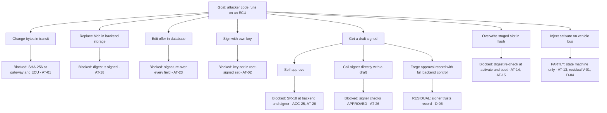
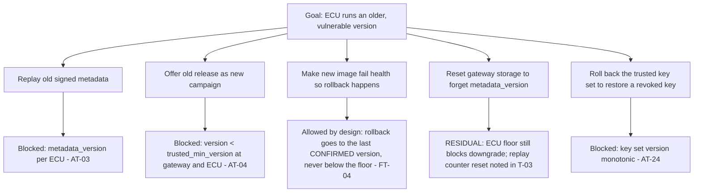
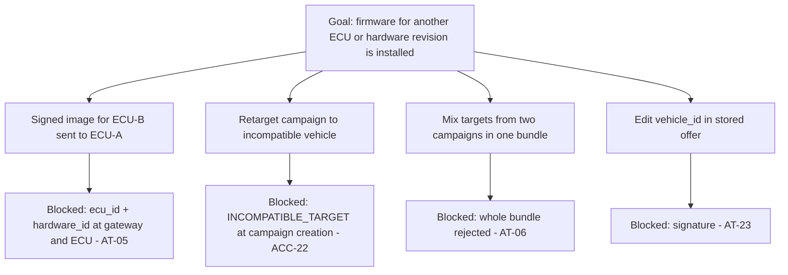
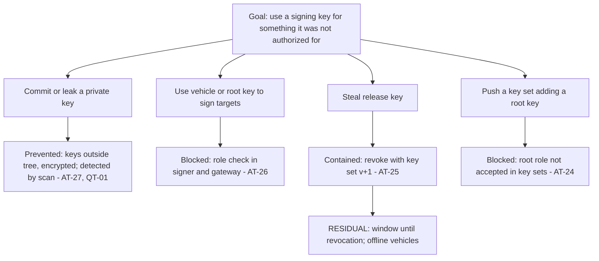

# Threat model: STRIDE worksheets, attack trees and threat catalog

Version 1.0-rc1. Lead: Student 3. Vehicle rows: Student 1. Backend rows: Student 2.

The catalog and scores are in `trace/threats.csv`. The sorted register with written rationale is in
[generated/risk_register.md](generated/risk_register.md).

> **Status.** The worksheets and scores below are **prepared drafts**. The guide schedules the team
> workshops for W5-D1 to W5-D5, where scores are moderated and agreed. Record the outcome in
> [governance.md](governance.md) §3. Do not present these scores as agreed until that has happened.

## 1 Method

- **Threat IDs:**
  - **T-01 to T-12:** guide threats.
  - **F-01 to F-05:** guide faults.
  - **V-01 to V-05:** vehicle threats added by S1.
  - **B-01 to B-09:** backend threats added by S2.
  - **K-01 to K-04:** key-lifecycle threats added by S3.
- **Workshop procedure (guide Section 7):**
  1. Take each process, data store, external actor and flow in [data_flows.md](data_flows.md).
  2. Ask the six STRIDE questions for it.
  3. Record each threat with the attacker from the attacker model
     ([student3_security_spec.md](student3_security_spec.md) §1).
  4. Merge duplicates.
  5. Score likelihood and impact from 1 to 5, each with a written reason.
- **Scoring:** Risk = Likelihood × Impact. Critical is 15–25, High 10–14, Medium 5–9, Low 1–4.
  Impact considers safety, firmware integrity, availability, key compromise, privacy, evidence loss
  and research credibility.
- **Treatment:** Every high or critical risk needs prevention, detection, recovery, a negative test
  and a residual-risk statement. `tools/check_trace.py` enforces this.

## 2 Result summary

There are 35 entries: **10 Critical, 17 High, 8 Medium, 0 Low.** Every one of the 27 high or critical
entries has an owner, controls, a negative test and a traceability-matrix row.

| Score | Critical and high-impact entries |
|---|---|
| 20 | T-01 firmware changed after signing; F-05 vehicle moves before activation |
| 15 | T-02 unknown or revoked key; T-04 downgrade; F-03 power loss; F-04 unhealthy image; V-05 spoofed safety inputs; B-02 self-approval; B-03 artifact substitution in storage; B-09 key committed to source control |
| 12 | T-03, T-05, T-08, T-10, T-11, V-03, B-01, B-04, B-05, B-07, B-08 |
| 10 | F-01, V-01, V-04, K-01, K-02, K-03 |

## 3 STRIDE worksheets

Each cell gives the threat IDs, or `-` with the reason the category does not apply.

### 3.1 Backend elements (prepared by S2)

| Element | S | T | R | I | D | E |
|---|---|---|---|---|---|---|
| HTTP API (process) | B-01 stolen or forged token; vehicle acting for another (AT-31) | B-08 replayed events | B-05 if events unaudited → SR-09 | B-07 errors and logs | B-06 oversized uploads; no rate limit (residual) | T-10, B-02 |
| Backend service (process) | - (identity comes from the API) | B-04 assignment edits | B-05 | - (no secrets held) | T-12 dependency cycle | B-02 self-approval |
| Database (store) | - | B-04 | B-05 audit deletion | A-12 personal data → PR-01 | - (single instance, out of scope) | - |
| Artifact store (store) | - | B-03 substitution | - | - (firmware is not confidential, ASM-08) | B-06 | - |
| Audit chain (store) | - | B-05 | B-05 | B-07 secrets in audit → NFR-05 | - | - |
| Operators (external) | B-01 | - | T-10 denial of actions → SR-09 | - | - | T-10 |

### 3.2 Signing and key elements (prepared by S3)

| Element | S | T | R | I | D | E |
|---|---|---|---|---|---|---|
| Signing service (process) | K-03 compromised release key | K-01 signing unapproved content | Key usage log | B-09 key leakage | - (offline in production) | K-01, K-04 key outside role |
| Private keys (store) | K-03 | - | - | B-09 committed to git | - | - |
| Trusted key set (flow and store) | K-02 forged key set | K-02 rollback | - | - | Expiry: a vehicle with an expired set must be re-provisioned (ASM-07) | K-04 |

### 3.3 Vehicle elements (prepared by S1)

| Element | S | T | R | I | D | E |
|---|---|---|---|---|---|---|
| Network to gateway (flow) | T-02 | T-01, T-03, T-04, T-05, T-06, T-07 | - | - (firmware not confidential) | T-08, T-09, F-01 | - |
| Gateway (process) | - | F-02 bookkeeping | V-02 false reports | - | T-08, T-09 | - |
| Gateway to ECU (flow) | V-01 malicious CAN peer | T-05 at ECU | V-02 | - | - | V-01 unsolicited activation |
| ECU state and slots (store) | - | V-03 flash corruption; V-04 boot manipulation | - | - | F-03 power loss; F-04 unhealthy image | - |
| Vehicle conditions (flow) | V-05 | V-05 | - | - | - | F-05 activation while moving |
| Manifest (flow) | - | T-11 | V-02 | - | - | - |

**Trust-boundary coverage** (check S3-T3, "all trust boundaries examined"):
- TB-1: §3.1 API rows
- TB-2: database, store and audit rows
- TB-3: §3.2
- TB-4: network rows
- TB-5: gateway-to-ECU and conditions rows
- TB-6: ECU state and slots

## 4 Attack trees

### 4.1 Malicious firmware installation

### 4.2 Downgrade to a vulnerable version

### 4.3 Wrong-target update

### 4.4 Key misuse

## 5 Workshop records

Fill in one row per workshop. The guide schedules W5-D1 to W5-D5.

| Date | Workshop | Participants | Elements covered | Threats added / merged | Scores changed (old → new, reason) | Open actions |
|---|---|---|---|---|---|---|
| | Vehicle STRIDE (W5-D1) | | | | | |
| | Backend STRIDE (W5-D1) | | | | | |
| | Attack trees (W5-D2) | | | | | |
| | Scoring normalization (W5-D3) | | | | | |
| | Residual risk review (W5-D5) | | | | | |

When a score changes, edit `trace/threats.csv`, then run `python tools/build_docs.py` and
`python tools/check_trace.py`, and add a change-log entry.
